# Структура проекта VLR Finance

## Mermaid диаграмма

```mermaid
graph TD
    Root[vlr-finance/]

    %% Корневые папки
    Root --> Apps[apps/]
    Root --> Packages[packages/]
    Root --> Infrastructure[infrastructure/]
    Root --> Proto[proto/]

    %% Apps - Микрофронты
    Apps --> Host[host/ - Next.js Host App]
    Apps --> AuthMF[auth-profile-mf/ - Next.js]
    Apps --> TerminalMF[terminal-mf/ - Next.js]
    Apps --> PortfolioMF[portfolio-mf/ - Next.js]
    Apps --> AICopilotMF[ai-copilot-mf/ - Next.js]

    %% Apps - Микросервисы
    Apps --> AuthService[auth-service/ - NestJS]
    Apps --> IngestorService[ingestor-service/ - NestJS]
    Apps --> PortfolioService[portfolio-service/ - NestJS]
    Apps --> AnalyticsService[analytics-service/ - NestJS]
    Apps --> AICopilotService[ai-copilot-service/ - NestJS]
    Apps --> BackgroundJobsService[background-jobs-service/ - NestJS]

    %% Packages
    Packages --> UIPackage[ui/ - Shadcn Components]
    Packages --> ConfigPackage[config/ - Biome, ESLint, TSConfig]
    Packages --> TypesPackage[types/ - TypeScript Types]
    Packages --> SchemasPackage[schemas/ - Zod Schemas]
    Packages --> APIClientPackage[api-client/ - RTK Query Setup]
    Packages --> UtilsPackage[utils/ - Utilities]
    Packages --> GRPCPackage[grpc/ - gRPC Generated Code]

    %% Infrastructure
    Infrastructure --> Docker[docker/ - Dockerfiles]
    Infrastructure --> DockerCompose[docker-compose/ - Compose Configs]
    Infrastructure --> K8s[k8s/ - Kubernetes Manifests]
    Infrastructure --> Scripts[scripts/ - Init Scripts]
    Infrastructure --> Migrations[migrations/ - DB Migrations]

    %% Migrations детализация
    Migrations --> PostgresMigrations[postgres/ - Prisma Migrations]
    Migrations --> ClickHouseMigrations[clickhouse/ - SQL Migrations]

    %% Docker Compose детализация
    DockerCompose --> BaseCompose[docker-compose.base.yaml]
    DockerCompose --> V1Compose[docker-compose.v1-auth.yaml]
    DockerCompose --> V2Compose[docker-compose.v2-terminal.yaml]
    DockerCompose --> V3Compose[docker-compose.v3-portfolio.yaml]
    DockerCompose --> V4Compose[docker-compose.v4-ai.yaml]
    DockerCompose --> V5Compose[docker-compose.v5-jobs.yaml]
    DockerCompose --> FullCompose[docker-compose.full.yaml]

    %% Proto
    Proto --> AuthProto[auth/ - auth.proto]
    Proto --> PortfolioProto[portfolio/ - portfolio.proto]
    Proto --> AnalyticsProto[analytics/ - analytics.proto]

    %% Стили
    classDef microfront fill:#e1f5ff,stroke:#01579b,stroke-width:2px
    classDef microservice fill:#fff3e0,stroke:#e65100,stroke-width:2px
    classDef package fill:#f3e5f5,stroke:#4a148c,stroke-width:2px
    classDef infra fill:#e8f5e9,stroke:#1b5e20,stroke-width:2px
    classDef proto fill:#fce4ec,stroke:#880e4f,stroke-width:2px

    class Host,AuthMF,TerminalMF,PortfolioMF,AICopilotMF microfront
    class AuthService,IngestorService,PortfolioService,AnalyticsService,AICopilotService,BackgroundJobsService microservice
    class UIPackage,ConfigPackage,TypesPackage,SchemasPackage,APIClientPackage,UtilsPackage,GRPCPackage package
    class Docker,DockerCompose,K8s,Scripts,Migrations,PostgresMigrations,ClickHouseMigrations,BaseCompose,V1Compose,V2Compose,V3Compose,V4Compose,V5Compose,FullCompose infra
    class AuthProto,PortfolioProto,AnalyticsProto proto
```



## Текстовое описание структуры

### Корневая структура

```
vlr-finance/
├── apps/                              # Микрофронты и микросервисы
├── packages/                          # Общие пакеты
├── infrastructure/                    # Инфраструктура
├── proto/                              # gRPC прото-файлы
├── .devin/                            # Devin конфигурация
├── .github/                           # GitHub Actions
├── .husky/                            # Git hooks
├── turbo.json                         # Turborepo конфигурация
├── pnpm-workspace.yaml                # pnpm workspaces
├── package.json                       # Root package.json
├── biome.json                         # Biome конфигурация
├── .env.example                       # Пример переменных окружения
└── .gitignore
```

### apps/ - Микрофронты (Next.js)

```
apps/
├── host/                              # Host Application (контейнер для микрофронтов)
├── auth-profile-mf/                   # Вертикаль 1: Auth & Profile
├── terminal-mf/                       # Вертикаль 2: Real-time Terminal
├── portfolio-mf/                      # Вертикаль 3: Portfolio & Analytics
└── ai-copilot-mf/                     # Вертикаль 4: AI Copilot
```

### apps/ - Микросервисы (NestJS)

```
apps/
├── auth-service/                      # Auth Service
├── ingestor-service/                  # Data Ingestor (Kafka producer)
├── portfolio-service/                 # Portfolio Service (CQRS Commands)
├── analytics-service/                 # Analytics Service (CQRS Queries)
├── ai-copilot-service/                # AI Copilot Service
└── background-jobs-service/           # Background Jobs (BullMQ)
```

### packages/ - Общие пакеты

```
packages/
├── ui/                                # Общие UI компоненты (Shadcn)
├── config/                            # Биоме, ESLint, TSConfig
├── types/                             # TypeScript типы
├── schemas/                           # Zod схемы (auth, user, portfolio)
├── api-client/                        # RTK Query setup
├── utils/                             # Утилиты
└── grpc/                              # gRPC сгенерированный код
```

### infrastructure/ - Инфраструктура

```
infrastructure/
├── docker/                            # Docker-файлы для всех сервисов
├── docker-compose/                     # Docker compose конфигурации
│   ├── docker-compose.base.yaml       # Базовые сервисы
│   ├── docker-compose.v1-auth.yaml    # Вертикаль 1
│   ├── docker-compose.v2-terminal.yaml # Вертикаль 2
│   ├── docker-compose.v3-portfolio.yaml # Вертикаль 3
│   ├── docker-compose.v4-ai.yaml     # Вертикаль 4
│   ├── docker-compose.v5-jobs.yaml   # Вертикаль 5
│   └── docker-compose.full.yaml      # Все сервисы
├── k8s/                               # Kubernetes манифесты (в конце проекта)
├── scripts/                           # Скрипты инициализации
│   ├── init-clickhouse.sh             # Создание таблиц ClickHouse
│   ├── init-ksqldb.sql                # ksqlDB стримы и таблицы
│   └── seed-data.sql                  # Seed данные для dev
└── migrations/                        # Миграции БД
    ├── postgres/                      # Prisma миграции
    └── clickhouse/                    # SQL миграции ClickHouse
```

### proto/ - gRPC прото-файлы

```
proto/
├── auth/
│   └── auth.proto                     # Auth Service контракт
├── portfolio/
│   └── portfolio.proto                # Portfolio Service контракт
└── analytics/
    └── analytics.proto                # Analytics Service контракт
```

## Связи между компонентами

### Микрофронты ←→ Микросервисы

```
host (Next.js)
  ↓ Module Federation
auth-profile-mf (Next.js)
  ↓ BFF (REST)
auth-service (NestJS)
  ↓ gRPC
ai-copilot-service (NestJS)
```

### Микросервисы ←→ Микросервисы

```
portfolio-service (NestJS)
  ↓ RabbitMQ (Events)
ai-copilot-service (NestJS)
  ↓ RabbitMQ (Events)
auth-service (NestJS)
```

### Инфраструктура

```
Микросервисы
  ↓ docker-compose
PostgreSQL, Redis, Kafka, RabbitMQ, MinIO, ClickHouse, Vector
  ↓ Vector
Grafana, Prometheus, Loki
```

## Запуск вертикалей

### Вертикаль 1 (Auth)
```bash
docker-compose -f docker-compose.base.yaml -f docker-compose.v1-auth.yaml up -d
```

### Вертикаль 2 (Terminal)
```bash
docker-compose -f docker-compose.base.yaml -f docker-compose.v2-terminal.yaml up -d
```

### Вертикаль 3 (Portfolio)
```bash
docker-compose -f docker-compose.base.yaml -f docker-compose.v3-portfolio.yaml up -d
```

### Вертикаль 4 (AI)
```bash
docker-compose -f docker-compose.base.yaml -f docker-compose.v4-ai.yaml up -d
```

### Вертикаль 5 (Jobs)
```bash
docker-compose -f docker-compose.base.yaml -f docker-compose.v5-jobs.yaml up -d
```

### Все сервисы
```bash
docker-compose -f docker-compose.base.yaml -f docker-compose.full.yaml up -d
```
